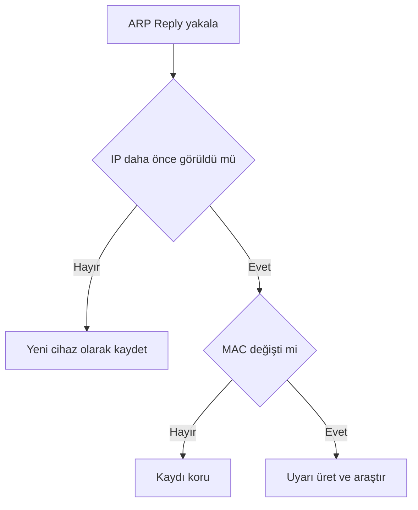

# ARP Watcher Öğrenci Uygulama Kılavuzu

Bu uygulama seçilen ağ arayüzündeki ARP Reply paketlerini pasif olarak dinler. Yeni görülen IP–MAC eşleşmelerini JSON dosyasına kaydeder; daha önce bilinen bir IP farklı MAC adresiyle görülürse uyarı üretir. Araç bir saldırı önleme sistemi değil, erken uyarı ve gözlem aracıdır.

# Öğrenme hedefleri

- ARP Reply içindeki psrc ve hwsrc alanlarını açıklamak

- IP–MAC eşleşmesini Python sözlüğünde saklamak

- Scapy sniff fonksiyonunun callback yapısını anlamak

- JSON dosyasına kalıcı kayıt işlemini izlemek

- MAC değişikliğinin neden kesin saldırı kanıtı olmadığını açıklamak

# Laboratuvar ön koşulları

| **Gereksinim**  | **Açıklama**                                                         |
|-----------------|----------------------------------------------------------------------|
| İşletim sistemi | Kali Linux veya Ubuntu tabanlı laboratuvar sistemi                   |
| Python          | Python 3 ve proje sanal ortamı                                       |
| Scapy           | Paket oluşturma veya yakalama kütüphanesi                            |
| Wireshark       | Paket ve PCAP inceleme aracı                                         |
| Yetki           | Yalnızca kendinize ait veya öğretim elemanının yetkilendirdiği ortam |

## Kurulum kontrolü

> python3 --version  
> python3 -m venv .venv  
> source .venv/bin/activate  
> python -m pip install scapy  
> python -c "import scapy; print(scapy.__version__)"

# Kod çalıştırılmadan önce yapılacak düzeltme

**Zorunlu kontrol:** Dosyadaki örnek MAC adreslerinden `aa:bb:sd:3d:cd:3a` geçersizdir; çünkü MAC adresinde yalnızca 0-9 ve A-F onaltılık karakterleri kullanılabilir. Ayrıca bu örnek IP’ler öğrencinin ağına ait olmayabilir. En güvenli başlangıç aşağıdaki gibi boş sözlüktür:

> ip_mac = {}

Öğretim elemanı doğrulanmış ağ geçidi ve laboratuvar cihazı bilgileri verirse sözlük yalnızca bu gerçek değerlerle doldurulmalıdır. `ip neigh` veya `arp -a` çıktısı kullanılabilir.

# Programın temel bileşenleri

| **Bileşen**       | **Görevi**                                                   |
|-------------------|--------------------------------------------------------------|
| ip_mac sözlüğü    | IP adresini bilinen MAC adresiyle eşleştirir                 |
| load_database     | JSON dosyasındaki eski kayıtları yükler                      |
| save_database     | Güncel sözlüğü güvenli geçici dosya üzerinden kaydeder       |
| watch_arp         | Her ARP Reply için yeni cihaz veya değişiklik kontrolü yapar |
| sniff             | Seçilen arayüzde ARP paketlerini yakalar                     |
| SIGINT işleyicisi | Ctrl+C sırasında kayıt yaparak programı kapatır              |

# Ağ arayüzünü bulma

> ip -br address  
> ip route

`ip route` çıktısındaki default rota hangi arayüzden çıkıyorsa, laboratuvar ağı için çoğunlukla o arayüz seçilir. Docker köprüleri fiziksel laboratuvar ağını göstermez.

# Uygulama adımları

1.  Başlangıç `ip_mac` sözlüğünü boşaltın veya doğrulanmış değerlerle düzeltin.

2.  Sanal ortamı etkinleştirin ve Scapy’yi doğrulayın.

3.  Ağ arayüzünüzü belirleyin.

4.  Paket yakalama gerektiği için sanal ortam Python’unu sudo ile çalıştırın.

5.  İkinci terminalden yetkili laboratuvar ağ geçidine sınırlı ARP isteği gönderin.

6.  Watcher terminalinde çıktıyı gözlemleyin ve Ctrl+C ile kapatın.

7.  JSON veritabanını inceleyin.

> cd ~/PycharmProjects/siberler  
> source .venv/bin/activate  
> python -m py_compile arp_watcher.py  
> ip -br address  
> sudo .venv/bin/python arp_watcher.py -i ARAYUZ_ADI

## İkinci terminalde gözlem trafiği

> ping -c 3 AG_GECIDI_IP  
> # Öğretim elemanı izin verdiyse daha doğrudan ARP gözlemi:  
> sudo arping -I ARAYUZ_ADI -c 3 AG_GECIDI_IP

# Beklenen çıktılar

> [YENİ CİHAZ] IP=192.168.56.1, MAC=08:00:27:12:34:56  
> [UYARI] IP-MAC eşleşmesi değişti!  
> [UYARI] Eski MAC : 08:00:27:12:34:56  
> [UYARI] Yeni MAC : 02:00:00:aa:bb:cc

İkinci çıktı yalnızca değişiklik olduğunu gösterir. DHCP yeniden ataması, ağ kartı değişimi, sanal makine yeniden oluşturma, VRRP/failover veya MAC randomization gibi meşru nedenler de olabilir.

# Wireshark ile doğrulama

| **Amaç**          | **Filtre**                         |
|-------------------|------------------------------------|
| Tüm ARP paketleri | arp                                |
| ARP Reply         | arp.opcode == 2                    |
| Belirli IP        | arp.src.proto_ipv4 == 192.168.56.1 |
| Belirli MAC       | eth.src == 08:00:27:12:34:56       |

# JSON veritabanı

> cat arp_watcher_db.json
>
> {  
> "192.168.56.1": "08:00:27:12:34:56",  
> "192.168.56.20": "08:00:27:65:43:21"  
> }

# Sorun giderme

| **Hata**                   | **Neden ve çözüm**                                                          |
|----------------------------|-----------------------------------------------------------------------------|
| -i/--interface gerekli     | Komuta -i ARAYUZ_ADI ekleyin                                                |
| Paket yakalama yetkisi yok | sudo .venv/bin/python arp_watcher.py -i ... kullanın                        |
| Scapy bulunamıyor          | Scapy’yi aynı sanal ortama kurun                                            |
| Veritabanı oluşmadı        | Yeni paket bekleyin veya programı Ctrl+C ile düzgün kapatın                 |
| Hiç ARP görünmüyor         | Doğru arayüzü seçin; mevcut ARP önbelleği nedeniyle yeni istek çıkmayabilir |
| Yanlış uyarı               | DHCP, failover ve sanallaştırma kayıtlarıyla karşılaştırın                  |

# Savunma bağlamı

- Dynamic ARP Inspection kullanmak

- DHCP Snooping bağlama tablosu oluşturmak

- Statik kritik eşleşmeleri doğrulamak

- Switch ve DHCP günlüklerini merkezi toplamak

- ARP değişikliklerini tek başına saldırı kanıtı saymamak

# Değerlendirme soruları

1. ARP op=2 neyi gösterir?

2. psrc ve hwsrc alanları hangi bilgileri taşır?

3. Neden sniff için yönetici yetkisi gerekir?

4. JSON dosyası ne zaman kaydedilir?

5. Aynı IP’nin farklı MAC ile görülmesinin üç meşru nedenini yazınız.
