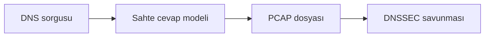

# DNS Sahteciliği Paket Analizi Öğrenci Uygulama Kılavuzu

**Kitaptaki başlık:** DNS Spoofing  
**Bölüm:** 6.7  
**Basılı sayfalar:** 79-81  
**Bölüm:** Bilgisayar Mühendisliği

## Amaç ve kapsam

Kitap, DNS sorgusuna gerçek sunucudan önce sahte cevap gönderilmesi fikrini, UDP 53 trafiğinin dinlenmesini ve hosts benzeri eşleme dosyasını açıklar. Güvenli sürüm yalnızca test.invalid alan adı için sorgu ve sahte cevap içeren PCAP oluşturur.

Bu paketteki `dns_spoofing_pcap_lab.py` dosyası saldırı üretmek için değil, kavramı yalıtılmış veya çevrimdışı laboratuvarda savunma açısından incelemek için hazırlanmıştır. Yalnızca size ait ya da açıkça izin verilmiş verileri ve sistemleri kullanın.



## Temel kavramlar

- DNS işlem kimliği sorgu ve yanıtı eşleştirir.
- QR biti sorgu ile cevabı ayırır.
- A kaydı adı IPv4 adresiyle eşler.
- DNSSEC veri kaynağı ve bütünlüğü için kriptografik doğrulama sağlar.

## Güvenli laboratuvar görevi

Dokümantasyon IP'leriyle DNS sorgusu ve sahte cevap çiftini çevrimdışı incelemek.

### Kurulum

```bash
python3 -m venv .venv
source .venv/bin/activate
python -m pip install scapy
```

### Çalıştırma

```bash
python dns_spoofing_pcap_lab.py --output dns_spoofing_demo.pcap
```

## İncelenecek noktalar

- UDP kaynak ve hedef portları
- DNS transaction ID
- QR biti
- Answer bölümündeki A kaydı

Kod önce sözdizimi açısından kontrol edilebilir:

```bash
python -m py_compile dns_spoofing_pcap_lab.py
```

Scapy kullanan uygulamalarda bir PCAP dosyası üretildiyse Wireshark ile açın. İlgili protokol katmanını genişletin; kaynak, hedef, bayrak ve yük alanlarını uygulamanın çıktısıyla karşılaştırın.

## Savunma yöntemleri

- DNSSEC doğrulaması kullanmak
- Güvenilir recursive resolver kullanmak
- DoH veya DoT politikasını yönetmek
- Beklenmeyen DNS cevaplarını IDS ile izlemek

## Sorun giderme

| Sorun | Kontrol |
|---|---|
| ModuleNotFoundError | Sanal ortamı etkinleştirip gerekli paketi kurun. |
| Dosya bulunamadı | PCAP veya çalışma dosyasının yolunu doğrulayın. |
| Permission denied | Canlı yakalama yapmayın; yetkili çevrimdışı PCAP kullanın. |
| Sonuç çıkmadı | Filtreyi, örnek veriyi ve beklenen protokolü kontrol edin. |

## Değerlendirme soruları

1. DNS transaction ID ne işe yarar?
2. QR biti neyi gösterir?
3. DNSSEC ne sağlar?
4. Sahte cevap neden önce ulaşmaya çalışır?

## Etik ve yasal sınır

Bu uygulama üretim ağına, üniversite ağına veya internet üzerindeki üçüncü taraf sistemlere yöneltilmemelidir. Kimlik bilgileri, oturum verileri ve PCAP dosyaları hassas kabul edilmelidir. Laboratuvar sonucu yalnızca ders kapsamında ve yetkili kişilerle paylaşılmalıdır.

## Kaynak notu

Bu kılavuz, *Understanding Network Hacks Attack and Defense with Python 3* kitabındaki **6.7 DNS Spoofing** başlığının 79-81 numaralı basılı sayfalarındaki kavramlar temel alınarak, güncel ve güvenli laboratuvar yaklaşımıyla yeniden düzenlenmiştir.
