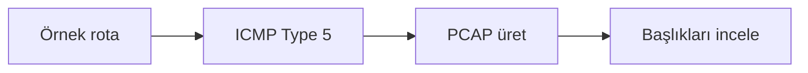

# ICMP Redirect Paket İncelemesi Öğrenci Uygulama Kılavuzu

**Kitaptaki başlık:** ICMP Redirection  
**Bölüm:** 5.10  
**Basılı sayfalar:** 60-62  
**Bölüm:** Bilgisayar Mühendisliği

## Amaç ve kapsam

Kitap, ICMP Redirect mesajının bir yönlendiricinin daha uygun ağ geçidi bildirmesi için tasarlandığını ve kötüye kullanıldığında trafiğin saldırgan üzerinden yönlendirilmesine çalışılabileceğini açıklar. Güvenli kod yalnızca örnek redirect paketini PCAP'a yazar.

Bu paketteki `icmp_redirect_pcap_lab.py` dosyası saldırı üretmek için değil, kavramı yalıtılmış veya çevrimdışı laboratuvarda savunma açısından incelemek için hazırlanmıştır. Yalnızca size ait ya da açıkça izin verilmiş verileri ve sistemleri kullanın.



## Temel kavramlar

- ICMP Type 5 yönlendirme değişikliği önerir.
- Mesaj eski ağ geçidi adına güvenilir görünmeye çalışabilir.
- Modern sistemlerde redirect kabulü çoğu ortamda kapatılmalıdır.
- Yönlendirme tablosu değişiklikleri izlenmelidir.

## Güvenli laboratuvar görevi

Dokümantasyon IP adresleriyle ICMP Redirect paket yapısını çevrimdışı incelemek.

### Kurulum

```bash
python3 -m venv .venv
source .venv/bin/activate
python -m pip install scapy
```

### Çalıştırma

```bash
python icmp_redirect_pcap_lab.py --output icmp_redirect_demo.pcap
```

## İncelenecek noktalar

- ICMP Type 5
- Gateway Address
- İç IP başlığı
- Ağdan gönderim yapılmadığı

Kod önce sözdizimi açısından kontrol edilebilir:

```bash
python -m py_compile icmp_redirect_pcap_lab.py
```

Scapy kullanan uygulamalarda bir PCAP dosyası üretildiyse Wireshark ile açın. İlgili protokol katmanını genişletin; kaynak, hedef, bayrak ve yük alanlarını uygulamanın çıktısıyla karşılaştırın.

## Savunma yöntemleri

- İstemcilerde ICMP redirect kabulünü kapatmak
- Yönlendiricilerde redirect üretimini sınırlamak
- Statik veya doğrulanmış yönlendirme kullanmak
- ICMP Type 5 için IDS alarmı oluşturmak

## Sorun giderme

| Sorun | Kontrol |
|---|---|
| ModuleNotFoundError | Sanal ortamı etkinleştirip gerekli paketi kurun. |
| Dosya bulunamadı | PCAP veya çalışma dosyasının yolunu doğrulayın. |
| Permission denied | Canlı yakalama yapmayın; yetkili çevrimdışı PCAP kullanın. |
| Sonuç çıkmadı | Filtreyi, örnek veriyi ve beklenen protokolü kontrol edin. |

## Değerlendirme soruları

1. ICMP Redirect hangi tür numarasını kullanır?
2. İç IP başlığı neden bulunur?
3. MITM riski nasıl oluşur?
4. Hangi sistem ayarı kontrol edilmelidir?

## Etik ve yasal sınır

Bu uygulama üretim ağına, üniversite ağına veya internet üzerindeki üçüncü taraf sistemlere yöneltilmemelidir. Kimlik bilgileri, oturum verileri ve PCAP dosyaları hassas kabul edilmelidir. Laboratuvar sonucu yalnızca ders kapsamında ve yetkili kişilerle paylaşılmalıdır.

## Kaynak notu

Bu kılavuz, *Understanding Network Hacks Attack and Defense with Python 3* kitabındaki **5.10 ICMP Redirection** başlığının 60-62 numaralı basılı sayfalarındaki kavramlar temel alınarak, güncel ve güvenli laboratuvar yaklaşımıyla yeniden düzenlenmiştir.
