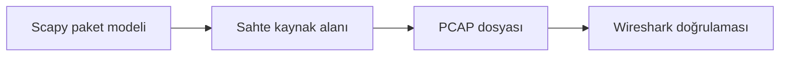

# IP Sahteciliği Paket Analizi Öğrenci Uygulama Kılavuzu

**Kitaptaki başlık:** IP Spoofing  
**Bölüm:** 5.6  
**Basılı sayfalar:** 54-55  
**Bölüm:** Bilgisayar Mühendisliği

## Amaç ve kapsam

Kitap, IP spoofing'i IP başlığındaki kaynak adresinin gerçek göndericiden farklı yazılması olarak tanımlar ve Scapy ile ICMP Echo Request örneği kurar. Bu sürüm paketi ağa göndermez; özel dokümantasyon adresleriyle PCAP üretir ve başlık alanlarının incelenmesini sağlar.

Bu paketteki `ip_spoofing_pcap_lab.py` dosyası saldırı üretmek için değil, kavramı yalıtılmış veya çevrimdışı laboratuvarda savunma açısından incelemek için hazırlanmıştır. Yalnızca size ait ya da açıkça izin verilmiş verileri ve sistemleri kullanın.



## Temel kavramlar

- IP kaynak alanı kriptografik kimlik doğrulama sağlamaz.
- Sahte kaynak, cevapların yanlış adrese gitmesine neden olabilir.
- Tek yönlü saldırılarda cevap alınması gerekmeyebilir.
- Ingress ve egress filtreleme sahte adresli trafiği azaltır.

## Güvenli laboratuvar görevi

192.0.2.0/24 dokümantasyon ağını kullanarak sahte kaynak alanlı ICMP paketini yalnızca PCAP dosyasına yazmak.

### Kurulum

```bash
python3 -m venv .venv
source .venv/bin/activate
python -m pip install scapy
```

### Çalıştırma

```bash
python ip_spoofing_pcap_lab.py --output ip_spoofing_demo.pcap
```

## İncelenecek noktalar

- IPv4 Source Address
- IPv4 Destination Address
- ICMP Type 8
- Paketin ağdan gönderilmediği

Kod önce sözdizimi açısından kontrol edilebilir:

```bash
python -m py_compile ip_spoofing_pcap_lab.py
```

Scapy kullanan uygulamalarda bir PCAP dosyası üretildiyse Wireshark ile açın. İlgili protokol katmanını genişletin; kaynak, hedef, bayrak ve yük alanlarını uygulamanın çıktısıyla karşılaştırın.

## Savunma yöntemleri

- BCP 38 ingress ve egress filtreleme
- Reverse Path Filtering
- IPsec AH veya ESP ile kimlik doğrulama
- Kaynak IP'yi tek başına güven göstergesi saymamak

## Sorun giderme

| Sorun | Kontrol |
|---|---|
| ModuleNotFoundError | Sanal ortamı etkinleştirip gerekli paketi kurun. |
| Dosya bulunamadı | PCAP veya çalışma dosyasının yolunu doğrulayın. |
| Permission denied | Canlı yakalama yapmayın; yetkili çevrimdışı PCAP kullanın. |
| Sonuç çıkmadı | Filtreyi, örnek veriyi ve beklenen protokolü kontrol edin. |

## Değerlendirme soruları

1. Kaynak IP neden güvenilir kimlik değildir?
2. Cevap paketleri nereye gider?
3. BCP 38 neyi amaçlar?
4. PCAP üretimi ile send() arasındaki fark nedir?

## Etik ve yasal sınır

Bu uygulama üretim ağına, üniversite ağına veya internet üzerindeki üçüncü taraf sistemlere yöneltilmemelidir. Kimlik bilgileri, oturum verileri ve PCAP dosyaları hassas kabul edilmelidir. Laboratuvar sonucu yalnızca ders kapsamında ve yetkili kişilerle paylaşılmalıdır.

## Kaynak notu

Bu kılavuz, *Understanding Network Hacks Attack and Defense with Python 3* kitabındaki **5.6 IP Spoofing** başlığının 54-55 numaralı basılı sayfalarındaki kavramlar temel alınarak, güncel ve güvenli laboratuvar yaklaşımıyla yeniden düzenlenmiştir.
