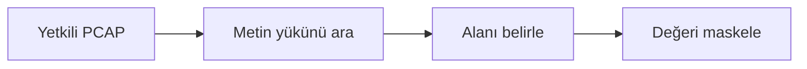

# Parola Sızıntısı Tespiti Öğrenci Uygulama Kılavuzu

**Kitaptaki başlık:** Password Sniffer  
**Bölüm:** 5.4  
**Basılı sayfalar:** 51-53  
**Bölüm:** Bilgisayar Mühendisliği

## Amaç ve kapsam

Kitaptaki örnek, TCP yüklerinde USER, LOGIN, PASS, TOKEN ve benzeri anahtarları düzenli ifadeyle arayarak açık metin kimlik bilgisi riskini gösterir. Güvenli sürüm yalnızca yetkili PCAP dosyasını inceler ve bulunan değerleri ekrana yazmak yerine maskeler.

Bu paketteki `password_leak_detector.py` dosyası saldırı üretmek için değil, kavramı yalıtılmış veya çevrimdışı laboratuvarda savunma açısından incelemek için hazırlanmıştır. Yalnızca size ait ya da açıkça izin verilmiş verileri ve sistemleri kullanın.



## Temel kavramlar

- Açık metin protokoller kimlik bilgilerini paket yükünde bırakabilir.
- Base64 şifreleme değildir.
- Düzenli ifade yanlış pozitif üretebilir; bulgu doğrulanmalıdır.
- Parola veya token hiçbir raporda açık biçimde gösterilmemelidir.

## Güvenli laboratuvar görevi

PCAP içindeki olası kimlik bilgisi alanlarını tespit etmek ve değerleri ifşa etmeden raporlamak.

### Kurulum

```bash
python3 -m venv .venv
source .venv/bin/activate
python -m pip install scapy
```

### Çalıştırma

```bash
python password_leak_detector.py --pcap yetkili_ornek.pcap
```

## İncelenecek noktalar

- Paket numarası
- Tespit edilen alan adı
- Maskelenmiş değer
- Kaynak ve hedef uçlar

Kod önce sözdizimi açısından kontrol edilebilir:

```bash
python -m py_compile password_leak_detector.py
```

Scapy kullanan uygulamalarda bir PCAP dosyası üretildiyse Wireshark ile açın. İlgili protokol katmanını genişletin; kaynak, hedef, bayrak ve yük alanlarını uygulamanın çıktısıyla karşılaştırın.

## Savunma yöntemleri

- HTTP yerine HTTPS kullanmak
- Telnet ve FTP yerine SSH/SFTP kullanmak
- Parola yerine kısa ömürlü token ve MFA kullanmak
- Log ve PCAP çıktılarında sırları maskelemek

## Sorun giderme

| Sorun | Kontrol |
|---|---|
| ModuleNotFoundError | Sanal ortamı etkinleştirip gerekli paketi kurun. |
| Dosya bulunamadı | PCAP veya çalışma dosyasının yolunu doğrulayın. |
| Permission denied | Canlı yakalama yapmayın; yetkili çevrimdışı PCAP kullanın. |
| Sonuç çıkmadı | Filtreyi, örnek veriyi ve beklenen protokolü kontrol edin. |

## Değerlendirme soruları

1. Base64 neden şifreleme değildir?
2. Yanlış pozitif ne demektir?
3. Neden bulunan parola ekrana yazılmamalıdır?
4. Hangi protokoller açık metin riskini artırır?

## Etik ve yasal sınır

Bu uygulama üretim ağına, üniversite ağına veya internet üzerindeki üçüncü taraf sistemlere yöneltilmemelidir. Kimlik bilgileri, oturum verileri ve PCAP dosyaları hassas kabul edilmelidir. Laboratuvar sonucu yalnızca ders kapsamında ve yetkili kişilerle paylaşılmalıdır.

## Kaynak notu

Bu kılavuz, *Understanding Network Hacks Attack and Defense with Python 3* kitabındaki **5.4 Password Sniffer** başlığının 51-53 numaralı basılı sayfalarındaki kavramlar temel alınarak, güncel ve güvenli laboratuvar yaklaşımıyla yeniden düzenlenmiştir.
