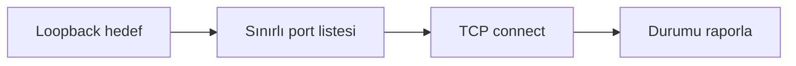

# Yerel Port Tarama Gösterimi Öğrenci Uygulama Kılavuzu

**Kitaptaki başlık:** Port Scanning  
**Bölüm:** 5.8  
**Basılı sayfalar:** 56-58  
**Bölüm:** Bilgisayar Mühendisliği

## Amaç ve kapsam

Kitap, tam TCP bağlantı taraması ile SYN taramasını karşılaştırır; SYN/ACK açık, RST kapalı, yanıtsız durum filtreli port göstergesi olabilir. Güvenli uygulama yalnızca loopback adresinde ve sınırlı port listesinde normal connect() denemesi yapar.

Bu paketteki `local_port_scanner.py` dosyası saldırı üretmek için değil, kavramı yalıtılmış veya çevrimdışı laboratuvarda savunma açısından incelemek için hazırlanmıştır. Yalnızca size ait ya da açıkça izin verilmiş verileri ve sistemleri kullanın.



## Temel kavramlar

- Açık port, dinleyen bir uygulama olduğunu gösterir.
- Kapalı port genellikle RST veya bağlantı reddi üretir.
- Filtreli durum paket filtrelemesi nedeniyle yanıtsız kalabilir.
- Tarama sonucu hizmetin güvenli olduğunu göstermez.

## Güvenli laboratuvar görevi

Yalnızca 127.0.0.1 üzerinde en fazla 20 TCP portunu bağlantı kurarak kontrol etmek.

### Kurulum

```bash
python3 -m venv .venv
source .venv/bin/activate
```

### Çalıştırma

```bash
python local_port_scanner.py --ports 22,80,443,8000
```

## İncelenecek noktalar

- Açık port
- Kapalı port
- Bağlantı süresi
- Yerel hedef doğrulaması

Kod önce sözdizimi açısından kontrol edilebilir:

```bash
python -m py_compile local_port_scanner.py
```

Scapy kullanan uygulamalarda bir PCAP dosyası üretildiyse Wireshark ile açın. İlgili protokol katmanını genişletin; kaynak, hedef, bayrak ve yük alanlarını uygulamanın çıktısıyla karşılaştırın.

## Savunma yöntemleri

- Gereksiz servisleri kapatmak
- Host güvenlik duvarı kullanmak
- Tarama oranlarını IDS ile izlemek
- Yönetim servislerini güvenilir ağlarla sınırlamak

## Sorun giderme

| Sorun | Kontrol |
|---|---|
| ModuleNotFoundError | Sanal ortamı etkinleştirip gerekli paketi kurun. |
| Dosya bulunamadı | PCAP veya çalışma dosyasının yolunu doğrulayın. |
| Permission denied | Canlı yakalama yapmayın; yetkili çevrimdışı PCAP kullanın. |
| Sonuç çıkmadı | Filtreyi, örnek veriyi ve beklenen protokolü kontrol edin. |

## Değerlendirme soruları

1. SYN/ACK neyi gösterir?
2. RST neyi gösterir?
3. Connect taraması ile SYN taraması arasındaki fark nedir?
4. Açık port neden tek başına zafiyet değildir?

## Etik ve yasal sınır

Bu uygulama üretim ağına, üniversite ağına veya internet üzerindeki üçüncü taraf sistemlere yöneltilmemelidir. Kimlik bilgileri, oturum verileri ve PCAP dosyaları hassas kabul edilmelidir. Laboratuvar sonucu yalnızca ders kapsamında ve yetkili kişilerle paylaşılmalıdır.

## Kaynak notu

Bu kılavuz, *Understanding Network Hacks Attack and Defense with Python 3* kitabındaki **5.8 Port Scanning** başlığının 56-58 numaralı basılı sayfalarındaki kavramlar temel alınarak, güncel ve güvenli laboratuvar yaklaşımıyla yeniden düzenlenmiştir.
